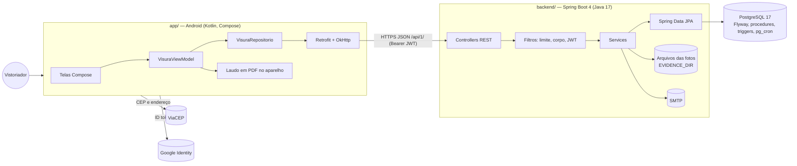
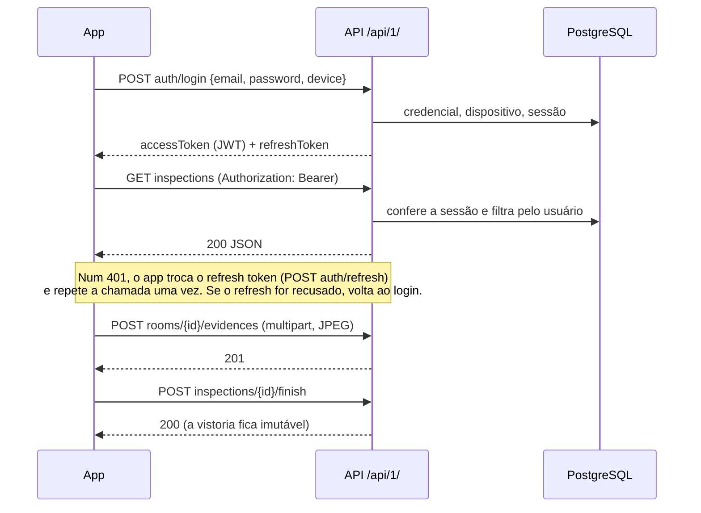

# Visura

Sistema de vistoria imobiliária. O app Android registra vistorias de entrada e de saída, ambiente por ambiente e item por item, com fotos, e gera o laudo em PDF. Todos os dados ficam numa API REST própria.

## Sumário

1. [Propósito](#propósito)
2. [Problema que o sistema resolve](#problema-que-o-sistema-resolve)
3. [Visão geral do ecossistema](#visão-geral-do-ecossistema)
4. [Arquitetura geral](#arquitetura-geral)
5. [Estrutura de diretórios](#estrutura-de-diretórios)
6. [Módulos](#módulos)
7. [Tecnologias](#tecnologias)
8. [Integração entre app e API](#integração-entre-app-e-api)
9. [Requisitos](#requisitos)
10. [Instalação e execução](#instalação-e-execução)
11. [Testes](#testes)
12. [Documentação dos módulos](#documentação-dos-módulos)

## Propósito

O Visura digitaliza a vistoria de imóveis para locação. No celular, o vistoriador:

- cadastra o imóvel, o proprietário e o inquilino;
- percorre os ambientes do imóvel, avaliando o estado de cada item;
- fotografa as evidências;
- finaliza a vistoria e entrega um laudo em PDF pronto para assinatura.

## Problema que o sistema resolve

A vistoria em papel, ou em planilhas soltas, causa três problemas:

- as fotos se perdem;
- fica difícil comparar a entrada com a saída do inquilino;
- é fácil alterar um laudo já assinado.

No Visura:

- **Comparação:** a vistoria de saída nasce como cópia dos ambientes e itens da vistoria de entrada, o que facilita a comparação.
- **Laudo imutável:** depois de finalizada, a vistoria não muda mais. Isso é garantido por regras no próprio banco de dados.
- **Fotos íntegras:** cada foto é guardada com o hash SHA-256, que é conferido em cada download.
- **Trabalho em equipe:** os imóveis e as vistorias podem ser compartilhados por uma empresa e seus membros.

## Visão geral do ecossistema

O repositório é um monorepo com dois módulos independentes, cada um com o próprio build:

| Módulo | Pasta | O que é | Build |
|---|---|---|---|
| App Android | [`app/`](app/) | Aplicativo do vistoriador | Gradle (wrapper em `app/`) |
| Backend | [`backend/`](backend/) | API REST, banco de dados e regras de negócio | Maven (wrapper em `backend/`) |

Serviços externos usados:

- **ViaCEP:** o app busca endereços nele.
- **Google:** o app faz o login pelo Credential Manager, e a API confere o ID token.
- **Servidor SMTP:** a API envia por ele o código de recuperação de senha. No desenvolvimento, o Mailpit faz esse papel.

## Arquitetura geral



## Estrutura de diretórios

```text
visura/
├── README.md              # este arquivo: visão geral do ecossistema
├── CONTRIBUTING.md        # fluxo de Git, commits, PRs e testes do repositório
├── .gitignore
├── app/                   # aplicativo Android (projeto Gradle independente)
│   ├── README.md
│   ├── CONTRIBUTING.md
│   ├── build.gradle.kts, settings.gradle.kts, gradle.properties
│   ├── gradlew, gradlew.bat, gradle/        # wrapper e catálogo de versões
│   └── src/                                 # main/, debug/, test/, androidTest/
└── backend/               # API REST (projeto Maven independente)
    ├── README.md
    ├── CONTRIBUTING.md
    ├── pom.xml, mvnw, mvnw.cmd, .mvn/
    ├── compose.yaml, docker/                # PostgreSQL com pg_cron e Mailpit para desenvolvimento
    ├── docs/db/app-role.sql                 # role do banco usada pela aplicação
    └── src/                                 # main/ (código, configuração e migrations) e test/
```

## Módulos

### App Android (`app/`)

- **Interface:** Jetpack Compose, com um único `NavHost` e um `VisuraViewModel` que guarda o estado do fluxo e roda as chamadas à API no `viewModelScope`.
- **Dados:**
  - A camada de dados (`VisuraRepositorio`) converte as respostas da API nos modelos de domínio (`model/`).
  - A `Sessao` guarda os tokens num SharedPreferences privado, fora do backup.
- **No próprio aparelho:** o app prepara as fotos (JPEG reduzido, com a rotação do EXIF aplicada) e gera o laudo em PDF.

Detalhes no [README do app](app/README.md).

### Backend (`backend/`)

- **API REST:** Spring Boot com segurança stateless:
  - access token JWT de validade curta;
  - refresh token opaco que troca a cada uso;
  - sessões controladas por dispositivo.
- **Banco:** o PostgreSQL concentra as regras que precisam valer mesmo sob concorrência, como constraints, procedures e triggers (por exemplo, a vistoria finalizada é imutável). O schema é versionado pelo Flyway.
- **Fotos:** ficam em disco (`EVIDENCE_DIR`), com o SHA-256 guardado no banco.

Detalhes no [README do backend](backend/README.md).

## Tecnologias

| Módulo | Principais tecnologias |
|---|---|
| App | Kotlin 2.2, Jetpack Compose (Material 3), Navigation Compose, Lifecycle ViewModel, Retrofit 2 + Gson, OkHttp 4, Credential Manager, ExifInterface; AGP 9.3.3, Gradle 9.5, minSdk 24, targetSdk 37 |
| Backend | Java 17, Spring Boot 4.1 (Web MVC, Security, Data JPA, Validation, Mail), PostgreSQL 17 com `pg_cron`, Flyway, Hibernate 7, java-jwt, Argon2id (BouncyCastle), MapStruct, Lombok, Google API Client; Maven |
| Testes | App: JUnit 4. Backend: JUnit 5, Mockito, MockMvc, Spring Security Test, PostgreSQL embutido (`embedded-postgres`) |

## Integração entre app e API



- **Versão:** todas as rotas ficam sob `/api/{versao}`. A versão atual é `1`.
- **Erros:**
  - A API responde no formato **RFC 9457** (`ProblemDetail`).
  - O app mostra a mensagem de `errors[].message` ou de `detail`.
- **Contrato:**
  - Os DTOs do app (`app/src/main/java/com/visura/data/remote/ApiModels.kt`) usam os mesmos nomes de campo da API.
  - Todas as rotas usadas pelo app (`VisuraApi.kt`) existem nos controllers do backend, com o mesmo método HTTP.
- **Endereço da API no app:**
  - Vem de `visura.api.url`, no `app/local.properties`.
  - O padrão é `http://10.0.2.2:8080/api/1/`, que é o computador visto pelo emulador.
  - O HTTP sem TLS só é aceito no build de debug.

## Requisitos

| Para | Precisa de |
|---|---|
| Backend | JDK 17 ou mais novo e Docker (para o PostgreSQL com `pg_cron` e o Mailpit do `compose.yaml`). Os testes não precisam de Docker |
| App | Android Studio compatível com o AGP 9.3, Android SDK 37 e um emulador ou aparelho com Android 7.0 (API 24) ou mais novo |
| Login com Google (opcional) | Um client OAuth "Web application" e um "Android" no Google Cloud |

## Instalação e execução

```bash
git clone https://github.com/joaobotoni/visura.git
cd visura
```

**1. Backend.** As variáveis de ambiente estão em [backend/README.md](backend/README.md#configuração-e-execução), e o passo a passo completo está em [backend/CONTRIBUTING.md](backend/CONTRIBUTING.md#executar-localmente).

```bash
cd backend
docker compose up -d
./mvnw -DskipTests package
java -jar target/visura-api-0.0.1-SNAPSHOT.jar
```

**2. App.** Abra a pasta `app/` no Android Studio, ou rode pelo terminal:

```bash
cd app
./gradlew installDebug
```

## Testes

```bash
cd backend && ./mvnw test                                  # API: unitários e fluxos contra um PostgreSQL embutido
cd app && ./gradlew testDebugUnitTest lintDebug            # app: testes na JVM e lint
```

A estratégia de testes de cada módulo está no [CONTRIBUTING.md](CONTRIBUTING.md#estratégia-de-testes).

## Documentação dos módulos

| Documento | Conteúdo |
|---|---|
| [app/README.md](app/README.md) | Arquitetura, navegação, estado, sessão, comunicação com a API, comandos de build e APK/AAB |
| [app/CONTRIBUTING.md](app/CONTRIBUTING.md) | Ambiente, padrões de código, nomenclatura, erros, lint e testes do app |
| [backend/README.md](backend/README.md) | Estrutura, modelagem de dados, regras de negócio, endpoints, segurança, configuração e testes da API |
| [backend/CONTRIBUTING.md](backend/CONTRIBUTING.md) | Ambiente, migrations, tratamento de erros, testes e padrão de código da API |
| [CONTRIBUTING.md](CONTRIBUTING.md) | Branches, Conventional Commits, Pull Requests e checklist de revisão |
