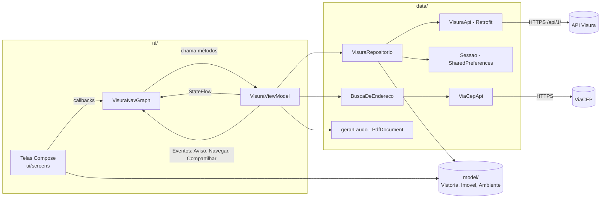
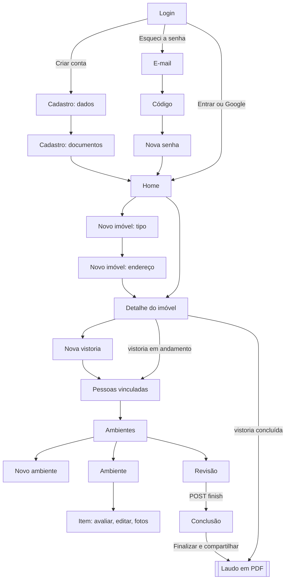
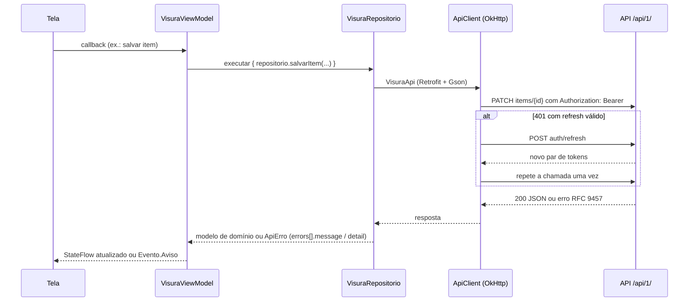

# Visura — App Android

Aplicativo Android do Visura, escrito em Kotlin e Jetpack Compose. Com ele, o vistoriador:

- cadastra imóveis;
- registra vistorias de entrada e de saída, ambiente por ambiente e item por item, com fotos e narração em áudio;
- gera o laudo em PDF no próprio aparelho.

Todos os dados ficam na [API do Visura](../backend/README.md). O app só guarda localmente a sessão, e cifrada.

## Sumário

- [Responsabilidades](#responsabilidades)
- [Arquitetura](#arquitetura)
- [Estrutura de diretórios](#estrutura-de-diretórios)
- [Fluxos principais](#fluxos-principais)
- [Navegação e estado](#navegação-e-estado)
- [Comunicação com a API](#comunicação-com-a-api)
- [Sessão e autenticação](#sessão-e-autenticação)
- [Persistência local](#persistência-local)
- [Câmera, fotos e laudo](#câmera-fotos-e-laudo)
- [Narração em áudio](#narração-em-áudio)
- [Tecnologias e versões](#tecnologias-e-versões)
- [Requisitos](#requisitos)
- [Configuração](#configuração)
- [Comandos](#comandos)
- [Contribuição](#contribuição)

## Responsabilidades

- **Conta:**
  - cadastro com e-mail e senha, em duas etapas, como pessoa física ou jurídica;
  - login e login com Google;
  - recuperação de senha por código enviado por e-mail.
- **Imóveis:** cadastro com tipo, categoria e endereço. O endereço é preenchido pelo CEP ou buscado por "rua, cidade, UF" no ViaCEP.
- **Vistorias:**
  - de entrada ou de saída; a de saída copia os ambientes e itens da entrada;
  - vínculo do proprietário e do inquilino;
  - ambientes do catálogo da API ou personalizados;
  - itens com estado, material, cor, observações e fotos.
- **Laudo:** PDF gerado no aparelho, com os dados, as fotos e as linhas de assinatura, compartilhado pelo seletor do Android.
- **Home e perfil:** lista de vistorias com o andamento e o responsável calculados pela API, e os dados da conta.

## Arquitetura

O app segue as camadas recomendadas pelo [guia de arquitetura do Android](https://developer.android.com/topic/architecture) (interface → estado → dados), num formato enxuto:

- um único `VisuraViewModel` para o fluxo inteiro;
- nenhum framework de injeção de dependência: a `VisuraApplication` cria as dependências uma vez, e o ViewModel é criado pela fábrica `VisuraViewModel.Fabrica`.



- **Interface (`ui/`):**
  - As telas não recebem `NavController`, repositório nem ViewModel; elas expõem callbacks com os dados digitados.
  - O estado de formulário fica na própria tela, com `rememberSaveable`.
- **Estado (`VisuraViewModel`):**
  - O ViewModel guarda o estado que passa de uma tela para outra e roda as chamadas à API no `viewModelScope`. Por isso, girar a tela não cancela uma ação.
  - Ele não guarda Activity nem NavController. O que depende da tela sai como evento.
- **Dados (`data/`):**
  - O repositório converte os DTOs da API nos modelos de `model/`.
  - Toda falha vira `ApiErro`, já com a mensagem pronta para o usuário.
  - `data/` nunca importa de `ui/`.

## Estrutura de diretórios

```text
app/
├── build.gradle.kts           # build do aplicativo (SDKs, BuildConfig, dependências)
├── settings.gradle.kts        # repositórios e nome do projeto Gradle
├── gradle.properties          # opções do Gradle (memória, configuration cache)
├── gradlew, gradlew.bat       # Gradle Wrapper
├── gradle/
│   ├── libs.versions.toml     # catálogo de versões das dependências
│   ├── gradle-daemon-jvm.properties
│   └── wrapper/               # gradle-wrapper.jar e .properties (Gradle 9.9.1)
└── src/
    ├── main/
    │   ├── AndroidManifest.xml          # permissão INTERNET, Application, Activity e FileProvider
    │   ├── keepRules/rules.keep         # regras do R8 para os DTOs lidos pelo Gson
    │   ├── res/                         # tema, ícones, strings e regras de backup e do FileProvider
    │   └── java/com/visura/
    │       ├── VisuraApplication.kt     # cria Sessao, cliente da API e VisuraRepositorio uma única vez
    │       ├── MainActivity.kt          # edge-to-edge, tema e VisuraNavGraph
    │       ├── model/                   # modelos de domínio (sem Compose)
    │       ├── data/
    │       │   ├── VisuraRepositorio.kt # chamadas à API -> modelos de domínio
    │       │   ├── ApiErro.kt           # erro único com a mensagem para o usuário; chamar { }
    │       │   ├── Sessao.kt            # tokens e dados da conta (SharedPreferences, valores cifrados)
    │       │   ├── Cifra.kt             # AES-256-GCM com chave do Android Keystore
    │       │   ├── BuscaDeEndereco.kt   # CEP e "rua, cidade, UF" no ViaCEP
    │       │   ├── Fotos.kt             # JPEG de até 2048 px, rotação do EXIF, arquivo da câmera
    │       │   ├── Laudo.kt             # laudo em PDF (PdfDocument)
    │       │   ├── Gravador.kt          # narração em M4A (MediaRecorder: AAC mono, 64 kbps)
    │       │   ├── EnvioDeNarracoes.kt  # envio das narrações em segundo plano (WorkManager)
    │       │   ├── LoginGoogle.kt       # Credential Manager -> ID token
    │       │   └── remote/              # VisuraApi, ApiModels (DTOs), ApiClient (OkHttp), ViaCepApi
    │       └── ui/
    │           ├── navigation/          # Routes, VisuraNavGraph, VisuraViewModel
    │           ├── components/          # Carregar (progresso, erro e "Tentar de novo")
    │           ├── screens/             # login, createaccount, forgotpassword, home, imoveis,
    │           │                        # vistoria, pessoas, ambientes
    │           └── theme/               # cores, tipografia, VisuraTheme, modifiers
    ├── debug/AndroidManifest.xml        # libera HTTP sem TLS no build de debug
    ├── homologacao/AndroidManifest.xml  # libera HTTP sem TLS no build de homologação
    ├── test/                            # testes na JVM (model/ e data/)
    └── androidTest/                     # testes instrumentados (cifra, sessão e telas Compose)
```

## Fluxos principais



- **Nova vistoria:**
  - A tela `NOVA_VISTORIA` cria a vistoria na API e sai da pilha de navegação.
  - O fluxo segue para pessoas vinculadas, ambientes, revisão (que finaliza na API) e conclusão.
  - Tocar numa vistoria em andamento retoma o fluxo a partir das pessoas.
- **Item novo:** as fotos tiradas antes de salvar o item ficam na tela e são enviadas logo depois que ele é criado. Num item já salvo, cada foto é enviada na hora.

## Navegação e estado

- **Rotas:**
  - As rotas são strings em `Routes.kt`, e os ids nelas são os UUIDs da API.
  - `VisuraNavGraph` é o único `NavHost`.
  - O destino inicial é `HOME` quando há sessão salva, e `LOGIN` quando não há.
- **Ações:**
  - Cada ação do usuário passa por `executar { }` no `VisuraViewModel` e roda no `viewModelScope`.
  - Enquanto a ação roda, o `StateFlow` `ocupado` bloqueia a tela e mostra o progresso.
- **Eventos:** o ViewModel manda três tipos por um `Channel`:
  - `Aviso`: mostra um snackbar;
  - `Navegar`: um comando sobre o `NavHostController`;
  - `Compartilhar`: o `Intent` do laudo.
  
  O `NavGraph` coleta os eventos com `repeatOnLifecycle(STARTED)`. Se um evento chega com o app em segundo plano, ele espera a tela voltar.
- **Estado entre telas:**
  - Os ambientes da vistoria aberta ficam em `VisuraViewModel.ambientes`.
  - O cadastro em duas etapas e a recuperação de senha guardam o e-mail e o código no `SavedStateHandle`.
  - Se o Android encerrar o processo, as telas de ambiente e item voltam para a lista, que recarrega da API.
- **Carga de tela:** `Carregar` (`ui/components/Carregamento.kt`) busca os dados de uma tela e mostra o progresso ou o erro.
- **Formulários:**
  - Os campos usam `rememberSaveable`; a lista de pessoas da vistoria usa um `Saver` próprio.
  - As senhas usam `remember` de propósito, para não irem para o estado salvo.

## Comunicação com a API



- `VisuraApi` declara os endpoints usados pelo app. A lista completa de rotas da API está no [README do backend](../backend/README.md#api).
- Os DTOs de `ApiModels.kt` usam os nomes de campo da API, em inglês. Os campos são anuláveis, porque o Gson ignora a nulabilidade do Kotlin.
- Os enums que vão para a API (`TipoImovel`, `CategoriaImovel`, `EstadoItem`, `PapelNaEmpresa`) têm `valorApi` e só podem ter os valores que a API aceita.
- As listas leem todas as páginas da API (`todasAsPaginas`).
- O endereço base vem de `BuildConfig.API_BASE_URL`. Veja [Configuração](#configuração).

## Sessão e autenticação

- **Login:** o login com e-mail e senha, o cadastro e o login com Google devolvem um access token (JWT) e um refresh token.
- **Token em cada chamada:** o `ApiClient` coloca o access token em todas as chamadas.
- **Renovação:**
  - Num `401`, o `ApiClient` troca o refresh token por um novo par e repete a chamada uma vez.
  - Se a API recusar o refresh, a sessão é limpa, `Sessao.expirou` dispara e o ViewModel volta ao login com um aviso.
  - Uma falha de rede não derruba a sessão.
- **Login com Google:**
  - `pedirContaGoogle` abre o seletor do Credential Manager. O seletor precisa da Activity, então roda no `NavGraph`, e só o ID token vai ao ViewModel.
  - Se a API responder `404` (não há conta com esse e-mail), o app abre o cadastro com o nome e o e-mail preenchidos.
- **Dispositivo:** o app gera um identificador e o envia no login, para a API controlar as sessões por dispositivo.

## Persistência local

O app não tem banco local. As narrações gravadas ficam em `files/narracoes` só até a API confirmar o recebimento (veja [Narração em áudio](#narração-em-áudio)). A `Sessao` guarda num SharedPreferences privado (`visura_sessao.xml`):

- **cifrados:** os tokens, o nome, o e-mail e o CPF da conta;
- **em texto puro:** o identificador do dispositivo, que não é segredo.

A cifragem (`Cifra.kt`) funciona assim:

- **Algoritmo:** AES-256-GCM, com a chave gerada e guardada no **Android Keystore**. A chave não sai do aparelho e, quando ele tem hardware seguro, não sai nem do hardware.
- **Gravação:** cada valor recebe um IV aleatório e uma tag de autenticação, então um valor adulterado é recusado. O formato gravado é `v1:` + Base64(IV + texto cifrado).
- **Migração:** um valor antigo, em texto puro, é lido uma vez e regravado cifrado. Quem já estava logado continua logado depois de atualizar o app.
- **Chave perdida:** se um valor não puder ser decifrado (por exemplo, porque os dados foram restaurados em outro aparelho), ele é descartado e o usuário entra de novo, sem o app fechar.

O arquivo também fica fora do backup do Android (`backup_rules.xml` e `data_extraction_rules.xml`). O perfil mostra o CPF que vem de `GET users/me`; o CPF salvo na sessão é só uma reserva.

## Câmera, fotos e laudo

- **Câmera:**
  - O app abre a câmera do sistema por `Intent`, então não pede a permissão `CAMERA`.
  - A foto é gravada num arquivo temporário exposto pelo `FileProvider` (`${applicationId}.arquivos`, `res/xml/arquivos.xml`).
  - Também dá para escolher fotos da galeria.
- **Envio das fotos:** `prepararFoto` converte cada foto em JPEG de até 2048 px e aplica a rotação do EXIF antes do envio (`POST rooms/{id}/evidences`).
- **Laudo:**
  - `gerarLaudo` monta o PDF com `PdfDocument`, em `Dispatchers.IO`, com as fotos baixadas de `GET evidences/{id}`.
  - O compartilhamento usa o mesmo `FileProvider`.
- **Serviços em segundo plano:** só o envio das narrações, pelo WorkManager (próxima seção).

## Narração em áudio

O vistoriador descreve o ambiente falando (cada item, o material, a cor e o estado) enquanto anda pelo cômodo. Na Fase 2, essa fala vai ser transcrita e a IA vai sugerir os itens preenchidos.

- **Gravação** (`Gravador.kt`): o cartão "Narração do ambiente", na tela do ambiente, grava em M4A (AAC mono, 44,1 kHz, 64 kbps, uns 0,5 MB por minuto). Pede a permissão `RECORD_AUDIO` no primeiro uso. Dá para pausar e continuar.
- **Onde a gravação vive:** no `VisuraViewModel`. Ela continua ao girar a tela e enquanto o vistoriador abre os itens e tira fotos. Só há uma gravação por vez. Se a Activity acabar de vez, a narração em andamento é concluída e enviada, não perdida.
- **Tela acesa:** com a tela apagada, o Android corta o microfone de apps em primeiro plano, então a tela fica acesa enquanto grava. Trocar de app durante a gravação também corta o som. Para isso seria preciso um serviço em primeiro plano do tipo microfone, que ainda não existe.
- **Envio** (`EnvioDeNarracoes.kt`): ao concluir, o arquivo vai para `files/narracoes` (não para o cache, que o Android pode limpar) e entra na fila do WorkManager. O envio espera haver internet, continua com o app fechado e tenta de novo com espera crescente quando não há resposta, a sessão expirou (401), há limite de requisições (429) ou o servidor falha (5xx). Outras recusas (vistoria finalizada, ambiente removido) são definitivas: o arquivo é apagado e o cartão mostra o motivo.
- **Na API**, a narração é uma evidência do ambiente, sem item, com `contentType` `audio/mp4`. A grade de fotos e o laudo em PDF usam só as evidências de imagem.
- **Limitação conhecida:** se a confirmação da API se perder depois do envio, a nova tentativa pode gravar a mesma narração duas vezes. Isso só deixa de acontecer com o modo sem internet da Fase 4, quando o app vai mandar um identificador da gravação.

## Tecnologias e versões

As versões ficam em [`gradle/libs.versions.toml`](gradle/libs.versions.toml).

| Item | Versão |
|---|---|
| Gradle (wrapper) | 9.9.1 |
| Android Gradle Plugin | 9.5.1 |
| Kotlin (plugin Compose) | 2.4.21 |
| JVM do daemon do Gradle | 21 (`gradle/gradle-daemon-jvm.properties`, baixada pelo foojay se não houver) |
| Java/Kotlin target | 11 |
| compileSdk / targetSdk / minSdk | 37 / 37 / 24 |
| Jetpack Compose BOM (Material 3, Material Icons Extended) | 2026.09.00 |
| Navigation Compose | 2.10.2 |
| Lifecycle (runtime, ViewModel e runtime para Compose) | 2.11.0 |
| Activity Compose / Core KTX | 1.13.0 / 1.19.1 |
| Retrofit + conversor Gson | 3.0.0 |
| OkHttp (logging interceptor) | 5.5.1 |
| Credential Manager / Google ID | 1.6.0 / 1.2.1 |
| ExifInterface | 1.4.2 |
| Testes | JUnit 4 (JVM); AndroidX Test e Compose UI Test (instrumentados) |

O app não tem flavors. Os build types são:

| Build type | R8 | HTTP sem TLS | Assinatura | API | Uso |
|---|---|---|---|---|---|
| `debug` | Não | Sim | Chave de debug | `visura.api.url` | Desenvolvimento |
| `homologacao` | Sim | Sim | Chave de debug | `visura.api.url` | Testar o build otimizado contra a API local antes de publicar |
| `release` | Sim | Não | Keystore de produção (`visura.release.*`) | `visura.api.url.release` (HTTPS, obrigatório) | Publicação |

O R8 reduz o APK de cerca de 22,8 MB (debug) para 2,4 MB. As regras que mantêm os DTOs lidos pelo Gson ficam em `src/main/keepRules/rules.keep`.

## Requisitos

- Um Android Studio recente, compatível com o AGP 9.5.
- O Android SDK com a plataforma 37.
- Um JDK para rodar o Gradle. O daemon pede a JVM 21 e a baixa sozinho se ela não estiver instalada.
- Um emulador ou aparelho com Android 7.0 (API 24) ou mais novo.
- A API rodando. Veja o [README do backend](../backend/README.md#configuração-e-execução).

## Configuração

No Android Studio, abra a pasta **`app/`** (não a raiz do repositório): ela é o projeto Gradle.

O `local.properties` fica em `app/`, não vai para o Git e é criado pelo Android Studio com o `sdk.dir`.

Cada chave também pode vir de uma variável de ambiente, útil em CI: troque os pontos por `_` e use maiúsculas. Por exemplo, `visura.api.url.release` vira `VISURA_API_URL_RELEASE`.

| Chave | Para quê | Padrão |
|---|---|---|
| `visura.api.url` | Endereço da API no debug e na homologação, terminado em `/api/1/`. Num aparelho físico, use o IP do computador na rede | `http://10.0.2.2:8080/api/1/` (o computador, visto pelo emulador) |
| `visura.google.client.id` | Client ID do tipo "Web application" do Google Cloud, o mesmo do `GOOGLE_CLIENT_ID` da API | Vazio: o botão do Google só avisa que não está configurado |
| `visura.api.url.release` | Endereço de produção da API, com `https://` e terminado em `/api/1/` | Obrigatório para o release: sem ele, o build falha e diz o que configurar |
| `visura.release.store.file` | Caminho do keystore de produção, fora do repositório | Sem ele, o release sai sem assinatura |
| `visura.release.store.password`, `visura.release.key.alias`, `visura.release.key.password` | Senha do keystore, alias e senha da chave | — |

O HTTP sem TLS só é liberado no debug e na homologação (`src/debug/` e `src/homologacao/`). O release só fala HTTPS.

**Keystore de produção.** O keystore é criado uma única vez e guardado em local seguro, com backup. Sem ele, não dá para publicar atualizações do app. Para criar:

```bash
keytool -genkeypair -keystore visura-release.jks -alias visura -keyalg RSA -keysize 4096 -validity 10000
```

**Login com Google:**

1. No Google Cloud Console, crie um client OAuth do tipo **Web application**. O ID dele vai em `visura.google.client.id` (no app) e em `GOOGLE_CLIENT_ID` (na API).
2. Crie também um client do tipo **Android**, com o pacote `com.visura` e o SHA-1 do certificado de debug, que aparece em `./gradlew signingReport`. O Google exige esse client, mas o app não usa o ID dele.

## Comandos

Rode todos os comandos dentro de `app/`. No Git Bash, use `./gradlew`; no PowerShell, use `.\gradlew.bat`.

```bash
./gradlew assembleDebug               # APK de debug: build/outputs/apk/debug/app-debug.apk
./gradlew installDebug                # instala no emulador ou aparelho conectado
./gradlew installHomologacao          # instala o build otimizado (R8), apontando para visura.api.url
./gradlew assembleRelease             # APK de release: build/outputs/apk/release/app-release.apk
./gradlew bundleRelease               # AAB de release (Google Play): build/outputs/bundle/release/app-release.aab
./gradlew testDebugUnitTest           # testes unitários na JVM (src/test)
./gradlew lintDebug                   # lint do Android: build/reports/lint-results-debug.html
./gradlew connectedDebugAndroidTest   # testes instrumentados (precisa de emulador ou aparelho)
./gradlew build                       # build completo, com testes e lint (inclui o release: exige visura.api.url.release)
```

Os comandos de release exigem `visura.api.url.release`. Com as chaves `visura.release.*` configuradas, o APK e o AAB já saem assinados. Para publicar na Google Play, envie o AAB.

## Contribuição

Leia o [CONTRIBUTING do app](CONTRIBUTING.md) e o [CONTRIBUTING da raiz](../CONTRIBUTING.md).
